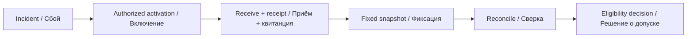

# Hackathon submission fallback kit

[English playbook](docs/en.md) · [Русский регламент](docs/ru.md)

Prepare an alternate submission channel before a deadline incident: activation, receipt, fixed files and reconciliation. Includes a local SHA-256 verifier and a JSON Schema.

Подготовьте резервный канал сдачи до сбоя: включение, квитанция, фиксированные файлы и сверка. В комплекте локальная проверка SHA-256 и JSON Schema.

## Quick start / Быстрый запуск

Node.js 22 or later / Node.js 22 или новее:

```sh
node verify.mjs examples/manifest.json examples/artifacts
node --test verify.test.mjs
```

The example is fictional. It contains one harmless text file. The verifier reads files inside the supplied directory and makes no network requests. It checks structure, file size and SHA-256. It reports lateness separately.

Пример вымышленный и содержит один обычный текстовый файл. Утилита читает файлы внутри указанного каталога без сетевых запросов. Она проверяет структуру, размер и SHA-256, отдельно отмечая опоздание.



## Use before the event / До события

Publish the fallback owner, activation notice, receipt fields and deadline rule. Use a channel whose access and retention your organizer can actually control. Store participant materials privately unless the event's rules and permissions allow publication.

Опубликуйте ответственного за резерв, объявление о включении, поля квитанции и правило дедлайна. Выберите канал с управляемым доступом и хранением. Материалы участников сохраняйте закрыто, если правила и разрешения не предусматривают публикацию.

## Boundaries / Границы

A matching hash only shows that a file matches the manifest. It does not prove authorship, arrival time, a working project or acceptance under the rules. The tool does not extract archives or run submitted code. Treat supplied timestamps and version labels as unverified metadata until the organizer reconciles them with the authoritative receipt.

Совпадение хеша подтверждает совпадение файла с манифестом. Оно не доказывает авторство, время поступления, работоспособность проекта или допуск. Утилита не распаковывает архивы и не запускает код. Время и обозначение версии требуют сверки с официальной квитанцией.

[Manifest schema](manifest.schema.json) · [Receipt / Квитанция](templates/receipt.md) · [Organizer kit](https://github.com/Stavleak/hackathon-organizer-kit) · [Contributing / Участие](CONTRIBUTING.md) · [MIT license](LICENSE)
